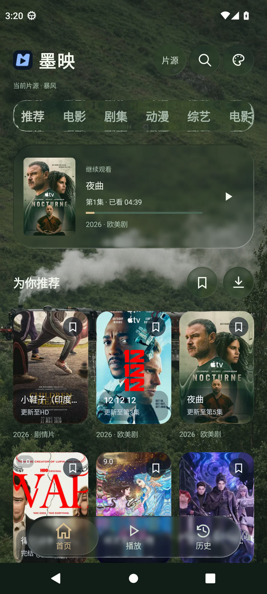
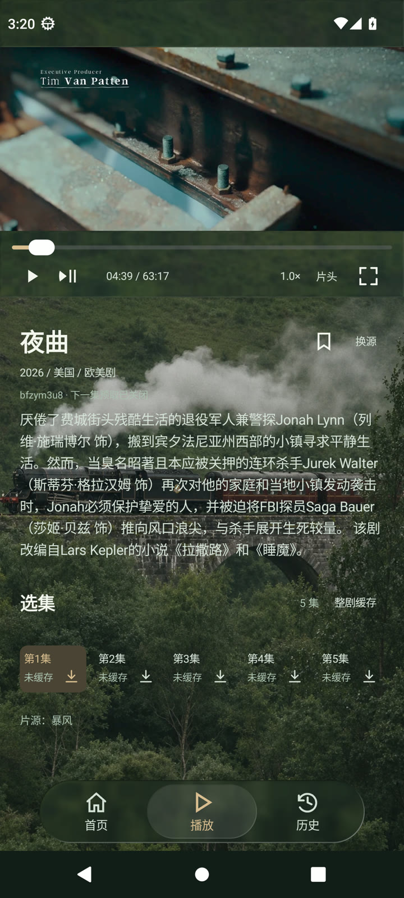
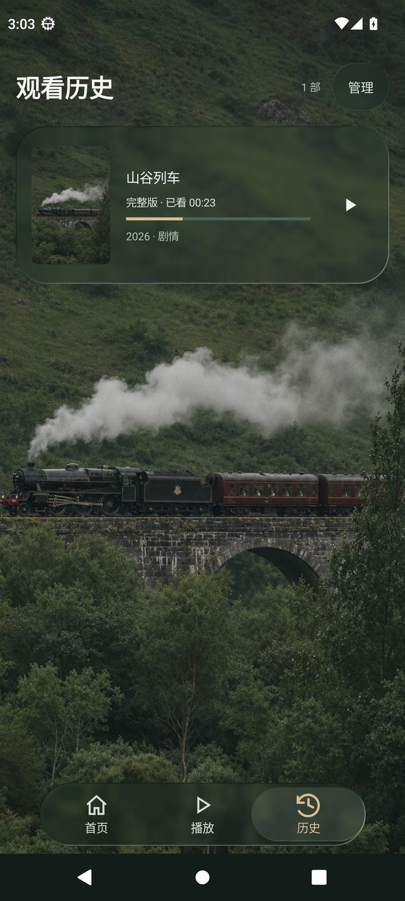
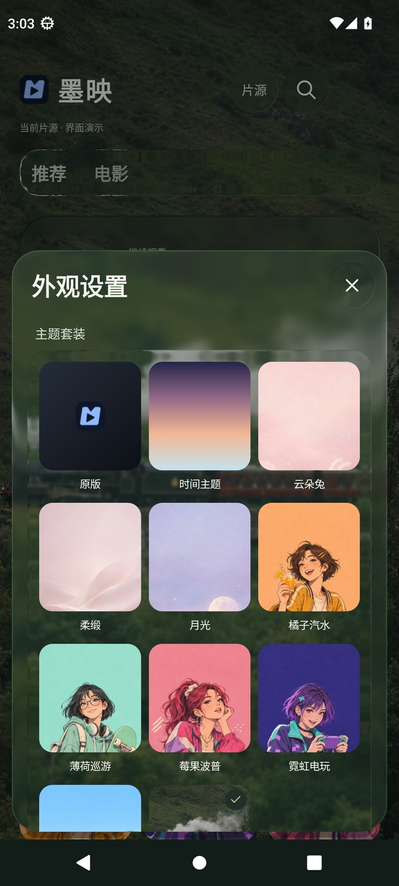

# 墨映 Moying · Android 视频播放器

墨映是一款用 **Kotlin 和 Jetpack Compose** 开发的原生 Android 视频播放器。支持 **MP4 和 HLS（M3U8）网络播放**、倍速和手势控制、选集换源、历史续播、跳过片头及离线缓存。

Moying is a native Android video player built with Kotlin and Jetpack Compose. It supports MP4 and HLS streaming, playback speed, resume playback, intro skipping, and offline downloads.

[下载 APK](https://github.com/Irolumn/moying-android/releases/latest) · [播放器功能](#播放器功能) · [片源与搜索](#片源与搜索) · [界面演示](#界面演示) · [源码构建](#打开和构建)

APK 支持 Android 8.0 及以上。完整的液态玻璃效果需要 Android 13 及以上。[历史版本](https://github.com/Irolumn/moying-android/releases)

## 播放器功能

| 功能 | 操作与支持范围 |
| --- | --- |
| **播放与选集** | 播放 MP4 和 HLS（M3U8），支持竖屏播放、横竖屏全屏、选集、播放下一集和切换线路。 |
| **倍速与手势** | 倍速可在 0.75× 到 2× 之间选择，支持时可长按临时 3×。双击播放或暂停，横滑调进度，左侧竖滑调亮度，右侧竖滑调音量。 |
| **跳过片头** | 把进度拖到正片开头，在「片头」里将当前时间设为结束点。设置按影片和线路记忆，之后可手动跳过，也可开启自动跳过。 |
| **历史续播** | 保存在本机的集数和播放进度可从「继续观看」或「观看历史」恢复。已过片头的续播会从记录的位置继续。 |
| **离线缓存** | 支持缓存单集或整剧、暂停、继续、重试和删除。缓存完整后可从「离线缓存」入口播放。 |
| **缓冲与预取** | 显示当前缓冲进度。可在「片源」面板开启下一集预取，默认关闭，开启后在 Wi-Fi 且当前集缓冲充足时运行。 |

## 片源与搜索

- **添加片源**。在首页右上角点「片源」，可粘贴 HTTP(S) 视频直链、订阅链接或文本，也可导入 JSON、XML、M3U、M3U8 和 TXT 文件。支持兼容的 TVBox 和 AppleCMS 片源配置。
- **搜索与分类**。通过首页搜索按钮按片名查找，或用电影、剧集、动漫和综艺分类浏览。常看的影片可加入收藏。

## 界面演示

截图来自运行墨映 1.9.39 的 Android 模拟器，使用「山谷列车」主题和本地示例片单。应用支持调节液态玻璃、切换深浅色模式、设置时间主题及更换壁纸。

| 首页 | 播放页 | 观看历史 | 外观设置 |
| --- | --- | --- | --- |
|  |  |  |  |

## 开源许可

墨映自有源码及相应开发文档采用 [MIT 许可证](LICENSE)。第三方代码、依赖及工具按各自的许可和版权声明使用，其中 Kyant Backdrop 的移植部分保留 [Apache 2.0 许可证](app/src/main/assets/licenses/Kyant-Backdrop-Apache-2.0.txt)。影视海报、壁纸、演示媒体和第三方二进制文件的权利按各自的授权处理。[第三方声明](THIRD_PARTY_NOTICES.md) · [资源说明](ASSETS.md)

## 历史变更

<details>
<summary>展开 1.3.0 至 1.8.6 的更新记录</summary>

### 1.8.6 更新

- 离线下载中途不再符合网络策略时暂停，恢复后从已保存的字节继续。
- 按下载记录保留共享缓存，最后一条记录删除且播放释放文件后回收磁盘空间。
- 底栏播放恢复离线影片、线路、集数和已确认进度。
- 去掉玻璃背景绘制的自触发循环，内容变化后仍更新玻璃采样。
- 补齐播放器兼容入口和缓存回归接口。Android 13 模拟器通过 7 组回归共 204 条断言。

### 1.8.4 更新

- 重新设计墨蓝底、冰蓝色的品牌标志，将 M 折角与镂空播放符号结合，替换旧红黑桌面图标。
- 首页“墨映”左侧直接复用桌面前景矢量和配色，保持相同的图形比例；品牌图案、普通/圆形回退与系统单色版统一引用一份路径。
- 保留自适应桌面裁切及 Android 13 单色资源，没有新增位图、依赖或运行时图片加载。
- 实际启动器和应用内截图、资源链及产物信息见 [品牌图标验收](BRAND_ICON_VALIDATION.md)。

### 1.8.3 更新

- 推荐海报恢复 1.8.2 之前的效果，去掉新增的白色内沿与加宽玻璃圈，保留胶囊展开窗口。
- 删除首页、历史、搜索和外观设置里的装饰性文案，合并历史页重复标题，精简静态提示。
- 分类共用一条平滑移动的下划线；图片改为静态淡色占位，首次加载短暂淡入，缓存命中直接显示。
- 自定义壁纸在解码后一次采样明暗，按深浅主题调整遮罩并为顶部提供渐变衬底，提高副字可读性，没有增加常驻动画。
- 变更范围和验证记录见 [简洁界面验收](MINIMAL_UI_VALIDATION.md)。

### 1.8.2 更新

- 推荐海报采用 6dp 玻璃留边，清晰海报内层配合轻微内沿，露出玻璃厚度；维持原有三列、按压倾斜和图片缓存。
- 片源、搜索、主题与背景共用胶囊展开动效：从真实入口坐标扩展为玻璃窗口，关闭时回收，文字按最终宽度布局并渐显。
- 片源设置改为可滚动浮窗；搜索支持自动聚焦、键盘搜索和查看结果，收起后保留关键词，首页可直接清空。
- 窗口避让状态栏、导航栏和键盘，支持返回与点击空白关闭，保持同一布局根内的实时玻璃采样。
- 构建与模拟器检查、片源管理回归结果见 [玻璃面板验收](GLASS_PANEL_VALIDATION.md)。

### 1.8.1 更新

- 当前播放优先调度；缓冲不足、跳转或暂停时释放下一集原生预准备，保留已缓存数据，失败后允许退避重试。
- HLS 音视频按播放位置同时预取，当前集采用有限前瞻窗口并按倍速调整，下一集不再从后台直接填完整清单。
- 远距离拖动采用稀疏 Range 缓存，重复及重叠区间复用磁盘数据；换源后断开旧下载，减少无效流量。
- 修复恢复缓存后的预算扣账、低磁盘余量回收及活动文件淘汰竞态，缓存总上限继续为 1 GiB。
- 网络恢复按用户播放意愿续播；暂停等待不会因准备完成自动播放。片单切换/搜索支持主动取消旧连接与整次调用超时。
- 已通过缓存、网络取消、原生播放器及片源管理共 152 条断言，见 [网络与缓冲验收](NETWORK_BUFFERING_VALIDATION.md)。

### 1.8.0 更新

- 首页「片源 / 导入」增加「管理」入口，点片源右侧的删除按钮并确认即可删除内置或导入的网络片源。
- 删除当前片源后自动选择剩余首个片源；网络片源全部删除后保留「本地 / 直链」。删除结果重启后仍保留，重新导入可恢复片源。
- 保留观看历史、播放地址和已添加直链；删除时清理站点目录缓存与检测结果，旧请求不会回填已删除站点的缓存。
- Android 13 模拟器通过 7 个场景、81 条断言，并完成删除确认、取消和重启的 UI 检查，见 [验收记录](SOURCE_DELETION_VALIDATION.md)。

### 1.4.0 更新

- 依据 [开源方案评估](LIQUID_GLASS_RESEARCH.md)，移植 Kyant Backdrop 的解析 SDF、圆弧透镜和方向高光；完整 Apache-2.0 许可证与修改声明随 APK 放在 `assets/licenses/`。
- 首页/历史改为共享 GPU GraphicsLayer → 窄条 RenderEffect → AGSL，移除导航 Bitmap 回读及慢滚动节流；完全隐藏后停止导航背景录制，上滑浮现始终按实际位置映射背景。
- 增加移动的第二层凸透镜、速度形变、触点折射与光照、按压压缩及弹性回弹；快速切换目标保留位置和速度。Shader 与模糊缓存，参数变化时才刷新效果快照，前景图标文字不参与扭曲。
- 保留页面、布局、原有滚动显隐和播放功能；没有新增依赖，Kotlin/AGP/Compose BOM 版本不变。Android 13+ 启用完整导航材质，旧版本及播放页保留高光备用样式。
- 已在 Android 13 模拟器运行真实远程海报页面并保存截图/录屏；单次暖态 GPU P95 为 16 ms，PSS 比基线增加约 5.12 MiB，GPU 缓存增加约 14.42 MiB。完整双指标、范围与限制见 [实测记录](LIQUID_GLASS_VALIDATION.md)，未据此宣称手机性能提升。

### 1.3.7 更新

- 导航上滑浮现时优先准备当前页面背景，动画期间按实际位置持续折射；固定底部采样区，避免移动时反复清空材质。
- 浮现期间背景变化最多每 **32 ms** 采样一次，完全隐藏后停止；保留原有快速滚动隐藏与停稳恢复行为。

### 1.3.6 更新

- 首页和历史快速滚动时，底部导航用 **200 ms** 动画向下移出屏幕；包含惯性滚动，停稳 **500 ms** 后滑回。
- 隐藏期间停止导航玻璃采样；页面切换及进入播放页恢复导航，片单尺寸和底部留白不随显隐改变。

### 1.3.5 更新

- 选集/换源的透明关闭层取消 `indication`，点击空白只收起面板，不绘制覆盖视频的按压反馈。
- 海报按控件目标尺寸解码，相同请求合并、离屏取消，最多 **3 张并发**；使用 **16 MiB** 内存缓存和 **48 MiB** 磁盘缩略图缓存，滚动时延后新下载与原图解码。
- 导航玻璃高速滚动时冻结上一张材质，慢滚动最多 **8 fps / 640 像素**，停稳 **120 ms** 后补采最长边 **720 像素**的清晰帧；页面其余帧正常绘制。
- 分发 APK 使用非 debuggable 的 **Release** 构建，不启用 R8；沿用已有安装证书，可覆盖安装并保留片源和观看记录。

### 1.3.4 更新

- 选集和换源玻璃面板浮在底部控制栏上方，面板与外侧关闭区域均避开控制栏，展开期间仍可操作播放、进度和全屏按钮。
- 面板展开时保持控制栏显示，再次点击同名按钮可收起；切换倍速会先关闭面板，较矮的视频区域使用紧凑选集布局。

### 1.3.3 更新

- 顶部至少 **40 dp** 和系统手势边缘起手时，整次触摸让给系统；下拉通知栏不误触播放手势，失焦时恢复临时倍速。
- 主界面统一管理播放及缓冲期间屏幕常亮，离开播放页恢复原状态；错误与重连保留已确认进度，网络恢复最多重试 **2 次**，单次等待设 **20 秒** 超时。
- 首页/历史底部导航改为动态页面采样玻璃，带浮动凸透镜式选中胶囊、双层亮边与轻微触摸形变。只抓导航后方窄条的脏帧，不把导航自身采回；当前采样策略见 1.3.5。API 33+ 实时折射，低版本或采样不可用时回退透明高光样式。

### 1.3.2 更新

- 长按画面临时以 **3×** 播放，松手恢复原倍速；双击画面切换播放/暂停。
- 横屏控制栏显示时，顶部中间显示系统当前时间 `HH:mm`，右侧显示电池图标与百分比，并更新充电及低电量状态；控制栏隐藏时一同收起。

### 1.3.1 更新

- 播放控制栏压缩为 **60 dp** 的圆角浮层；倍速菜单单独展开，不增加控制栏高度。
- Android 13 / API 33 及以上的视频区使用真实背景折射：通过 Surface PixelCopy 约 24 fps 取帧，最长边缩至 640 像素并采用三缓冲，再由独立 AGSL 着色器采样视频背景、计算圆角边缘折射及少量色散。文字和按钮在折射层之后原样绘制。
- 低版本、没有可用视频帧或驱动不支持时，回退原有透明底与边缘高光样式。首页片源面板等普通控件仍用常规玻璃；底部导航的页面采样见 1.3.3。没有新增第三方依赖，参考与授权见 `THIRD_PARTY_NOTICES.md`。

### 1.3.0 基础功能

- 首页状态由主界面常驻持有，进入播放页或历史后返回，保留片源、分类、关键词、已加载页、片单和滚动位置。
- 播放器新增左侧纵滑调亮度、右侧纵滑调音量、横滑松手定位、真实缓冲进度和下一集预准备；全屏内可选集、切换播放线路和查找同片其他源，换源延续当前集数与进度。
- “片源 / 导入”支持粘贴订阅 URL 或文本，以及选择本地 JSON、M3U、M3U8、TXT、XML 文件（每份最多 4 MiB）。支持 TVBox 单仓/多仓 JSON、AppleCMS JSON/XML、EXTINF 频道列表、`名称,地址` 文本和 HTTP(S) 媒体直链；不兼容条目会跳过并显示统计。保留添加 MP4/M3U8 直链后立即播放的入口。
- 默认配置包含 **15 个远程源：13 个 CMS 采集接口、2 个公开 M3U 列表**，另有“本地 / 直链”入口；数量表示配置项，不代表每条媒体或之后的可用性保证。远程配置快照为 2026-11-02，来源信息在 `TvBoxSources.json` 中保留。
- 首页、导航和片源面板使用透明底、细边高光与触点响应的常规玻璃材质，前景文字保持清晰。

</details>

## 固定构建环境

| 项目 | 固定版本 |
| --- | --- |
| Kotlin / Compose Compiler Gradle Plugin | **2.2.21**（两者同版） |
| Android Gradle Plugin | **8.7.3** |
| Gradle Wrapper | **8.9**（发行包 SHA256 已固定） |
| JDK / JVM bytecode target | **17** |
| Compose BOM | **2024.12.01** |
| Compose UI / Foundation / Runtime / Tooling | **1.7.6**（由 BOM 解析） |
| AndroidX Activity Compose | **1.9.3** |
| AndroidX Core KTX | **1.15.0** |
| compileSdk / targetSdk | **35 / 35** |
| minSdk | **26**（Android 8.0） |

以上全部为已发布稳定版，没有 alpha、beta、RC 依赖，没有 OptIn 或实验性 API。BOM 固定的是一组经过匹配的稳定版本，并非声明为当前最新版本。

兼容性依据：[Kotlin Gradle 支持矩阵](https://kotlinlang.org/docs/gradle-configure-project.html)、[Compose Compiler 插件](https://plugins.gradle.org/plugin/org.jetbrains.kotlin.plugin.compose/2.2.21)、[AGP 8.7 兼容表](https://developer.android.com/build/releases/agp-8-7-0-release-notes)、[Compose BOM 说明](https://developer.android.com/develop/ui/compose/bom)、[Activity 发布说明](https://developer.android.com/jetpack/androidx/releases/activity)、[Core 发布说明](https://developer.android.com/jetpack/androidx/releases/core)。

## 打开和构建

确保安装 JDK 17、Android SDK Platform 35 和 Build Tools 35.0.0（AGP 默认 34.0.0 也可）。首次同步需要网络下载官方 Google / Maven Central / Gradle 依赖。

```powershell
# 推荐：在当前中文目录直接运行，不需要挪动工程。
.\build-debug.ps1 -JdkPath 'C:\path\to\jdk-17'
# SDK 不在默认目录时：
.\build-debug.ps1 -JdkPath 'C:\path\to\jdk-17' -SdkPath 'D:\Android\Sdk'
# 打包 Release，并通过 ADB 覆盖安装到已授权的目标手机。
.\build-debug.ps1 -Task ':app:assembleRelease' -DeviceSerial '<adb devices 显示的序列号>'
# 只打包时可加 -SkipInstall。
```

APK 输出位置：调试版为 `app/build/outputs/apk/debug/app-debug.apk`，分发 Release 为 `app/build/outputs/apk/release/app-release.apk`。SDK 路径由 Android Studio 生成 `local.properties`，该文件不应进入版本库。不要直接用机器上的 JDK 26 运行此 Gradle 8.9 工程。

`build-debug.ps1` 自动寻找 `JAVA_HOME` 或本工作区的便携 JDK 17；它检测 SDK 35、选择两个空闲 ASCII 盘符临时映射工程和 SDK、以 `--no-daemon` 调用官方 Wrapper，并在 `finally` 中还原环境变量、本机 `local.properties` 和盘符，不改全局环境，不下载额外工具。这样当前含中文用户名及目录也能直接构建，不启用实验性路径检查开关。Android Studio 若直接打开中文工程路径，会触发 AGP 8.7 的路径检查；可用此脚本构建，或将源码放到 `D:\Android\Moying` 等英文目录后在 IDE 打开。

## 交互和维护

- 首页：三列海报、类型筛选、搜索、分页和续播；点击右上角“片源 / 导入”可切换片源、导入订阅或文件、添加视频直链。
- 播放：通过 Android 原生 MediaPlayer 真正播放网络视频，支持播放/暂停、进度拖动、倍速、选集、横屏全屏、加载状态和失败重试。
- 历史：保存单集和毫秒进度，支持续播、逐条删除、确认后清空；SharedPreferences 在重启后恢复历史。
- 所有颜色、字号、行高、间距、圆角、图标路径和视觉尺寸均位于 `Theme.kt`；领域常量在 `Models.kt`，不把分页业务规则放进主题。
- 默认使用 `TvBoxMovieRepository` + `AndroidPlayerController`，远程源位于 `app/src/main/assets/TvBoxSources.json`；“本地 / 直链”由 `SourceMovieRepository` 读取 `PlaySources.json`。Mock 与独立 CMS 实现保留备用。
- 片单和海报加载在 IO 线程执行；用户导入的地址与观看进度保存在本机。
- `MainActivity` 使用 Compose Pager 在首页、播放页和观看历史之间切换。全屏通过 Activity 方向与系统栏控制完成。
- 海报仅用于界面演示，素材来源见本目录 `ASSETS.md`；正式发行前应替换为自有或获授权内容。

## 文件清单

下列路径均相对于本 Android 工程根目录。

| 路径 | 一句话用途 |
| --- | --- |
| `README.md` | 构建环境、运行方法、维护说明及文件清单。 |
| `ASSETS.md` | 列明演示海报与背景的来源页面。 |
| `THIRD_PARTY_NOTICES.md` | 当前移植代码的版权、许可、修改边界与历史研究记录。 |
| `LIQUID_GLASS_RESEARCH.md` | 九个候选的比较、三套最佳源码分析、来源固定提交与选择理由。 |
| `LIQUID_GLASS_VALIDATION.md` | Android 13 模拟器的新旧真实截图、交互和 GPU/内存原始结果及边界。 |
| `build-debug.ps1` | 检测 JDK17/SDK，临时映射 ASCII 盘符并构建，结束后恢复环境。 |
| `.gitignore` | 排除缓存、构建产物和本机 SDK 路径。 |
| `settings.gradle.kts` | 配置官方依赖仓库并只包含 app module。 |
| `build.gradle.kts` | 固定 AGP、Kotlin 和 Compose 编译插件版本。 |
| `gradle.properties` | 固定 AndroidX、JVM 内存和 UTF-8 设置。 |
| `gradlew` | macOS / Linux 的官方 Gradle Wrapper 启动脚本。 |
| `gradlew.bat` | Windows 的官方 Gradle Wrapper 启动脚本。 |
| `gradle/wrapper/gradle-wrapper.jar` | 启动固定版本 Gradle 的官方引导器。 |
| `gradle/wrapper/gradle-wrapper.properties` | 固定 Gradle 8.9 下载地址和 SHA256。 |
| `app/build.gradle.kts` | 声明 SDK、JVM目标与全部稳定 AndroidX 依赖。 |
| `app/src/main/AndroidManifest.xml` | 声明 App 入口、基础系统窗口主题和方向配置。 |
| `app/src/main/res/values/styles.xml` | 提供无 ActionBar 的宿主窗口样式，界面本身由 Compose 自绘。 |
| `app/src/main/java/com/moying/app/MainActivity.kt` | 手动装配接口实现，维护简单页面状态与全屏窗口。 |
| `app/src/main/java/com/moying/app/HomeScreen.kt` | 首页片单、分类、搜索、分页与续播入口。 |
| `app/src/main/java/com/moying/app/HomeState.kt` | 常驻保存首页筛选、加载页、结果和滚动，调度目录请求与导入。 |
| `app/src/main/java/com/moying/app/PosterLoader.kt` | 按目标尺寸加载海报，合并与取消请求，限制三并发并管理内存和磁盘缩略图缓存。 |
| `app/src/main/java/com/moying/app/SourceImportPanel.kt` | 片源切换、粘贴订阅、本地文档导入及直链入口。 |
| `app/src/main/java/com/moying/app/SourceImport.kt` | 有界下载与 JSON/M3U/TXT/XML 解析、去重及多线路规范化。 |
| `app/src/main/java/com/moying/app/TvBoxMovieRepository.kt` | 管理采集源和直播列表、导入持久化与同片其他源查询。 |
| `app/src/main/java/com/moying/app/GlassSurface.kt` | 统一玻璃组件，视频区接实时折射，其余区域及不支持设备使用透明高光样式。 |
| `app/src/main/java/com/moying/app/VideoBackdrop.kt` | Surface PixelCopy 约 24 fps 捕获最长边 640 像素视频帧，管理三缓冲与 root 坐标。 |
| `app/src/main/java/com/moying/app/VideoRefraction.kt` | API 33+ 隔离的独立 AGSL 背景折射、BitmapShader 采样和降级入口。 |
| `app/src/main/java/com/moying/app/PageBackdrop.kt` | 共享页面 GPU 图层，隔离导航自身与旧页，完全隐藏时停止录制。 |
| `app/src/main/java/com/moying/app/NavLiquidGlass.kt` | 导航窄条背景投影、连续弹簧透镜、按压与触点反馈。 |
| `app/src/main/java/com/moying/app/ScrollNavigationState.kt` | 观察快滚及惯性，管理导航自动隐藏与停稳后浮现。 |
| `app/src/main/java/com/moying/app/NavigationGlassEffect.kt` | Kyant 光学算法移植、双透镜 AGSL、高光和缓存的 GPU 效果绑定。 |
| `app/src/main/assets/licenses/Kyant-Backdrop-Apache-2.0.txt` | 随 APK 分发 Kyant 的完整 Apache-2.0 许可证。 |
| `app/src/main/assets/licenses/NOTICE-Backdrop.txt` | 随 APK 分发源码来源、版权、固定提交及修改说明。 |
| `app/src/main/java/com/moying/app/PlayerScreen.kt` | 真实视频、进度、倍速、选集和全屏 UI。 |
| `app/src/main/java/com/moying/app/PlayerGestures.kt` | 处理画面显隐、双击播放/暂停、长按临时 3×、亮度、音量与横滑定位。 |
| `app/src/main/java/com/moying/app/GestureExclusion.kt` | 按真实窗口系统边缘让行触摸，并在失焦时取消手势和恢复倍速。 |
| `app/src/main/java/com/moying/app/PlayerStatusBar.kt` | 监听系统时间、电量及充电广播，呈现横屏顶部时钟与电池状态。 |
| `app/src/main/java/com/moying/app/HistoryScreen.kt` | 历史列表、续播、逐条删除与清空。 |
| `app/src/main/java/com/moying/app/Theme.kt` | 集中定义全部颜色、字体、间距、圆角、视觉尺寸和图标。 |
| `app/src/main/java/com/moying/app/Components.kt` | 无 Material 默认样式的公共文字、按钮、图像、导航和进度组件。 |
| `app/src/main/java/com/moying/app/Models.kt` | 定义影片、历史、分页模型与领域行为常量。 |
| `app/src/main/java/com/moying/app/MockData.kt` | 独立维护12部示例影片及首次使用的历史记录。 |
| `app/src/main/java/com/moying/app/MovieRepository.kt` | 声明影片分页和历史读写接口。 |
| `app/src/main/java/com/moying/app/MockMovieRepository.kt` | 提供假片单查询并在本地持久化观看历史。 |
| `app/src/main/java/com/moying/app/PlayerController.kt` | 声明 prepare、play、pause、seek、setSpeed、getPosition、getDuration 抽象。 |
| `app/src/main/java/com/moying/app/SourceMovieRepository.kt` | 读取独立片源文件，保存用户片源和观看记录。 |
| `app/src/main/java/com/moying/app/AndroidPlayerController.kt` | 封装稳定的平台 MediaPlayer、异步准备和错误状态。 |
| `app/src/main/java/com/moying/app/VideoSurface.kt` | 绑定和释放视频画布。 |
| `app/src/main/assets/PlaySources.json` | 四部公开正片的真实视频地址及来源署名。 |
| `app/src/main/assets/TvBoxSources.json` | 15 个默认远程源、原始配置来源与快照说明。 |
| `app/src/main/java/com/moying/app/MockPlayerController.kt` | 用单调时钟模拟播放、暂停、倍速和边界限制。 |
| `app/src/main/assets/long-season.jpg` | 《漫长的季节》示例封面。 |
| `app/src/main/assets/dune.jpg` | 《沙丘2》示例封面。 |
| `app/src/main/assets/interstellar.jpg` | 《星际穿越》示例封面。 |
| `app/src/main/assets/severance.webp` | 《人生切割术》示例封面。 |
| `app/src/main/assets/blossoms.webp` | 《繁花》示例封面。 |
| `app/src/main/assets/oppenheimer.jpg` | 《奥本海默》示例封面。 |
| `app/src/main/assets/past-lives.jpg` | 《过往人生》示例封面。 |
| `app/src/main/assets/grand-budapest.jpg` | 《布达佩斯大饭店》示例封面。 |
| `app/src/main/assets/inception.jpg` | 《盗梦空间》示例封面。 |
| `app/src/main/assets/spirited-away.jpg` | 《千与千寻》示例封面。 |
| `app/src/main/assets/wandering-earth.webp` | 《流浪地球2》示例封面。 |
| `app/src/main/assets/glory.webp` | 《黑暗荣耀》示例封面。 |
| `app/src/main/assets/player-backdrop.jpg` | 《沙丘2》播放页的模拟背景。 |
| `app/src/main/assets/severance-backdrop.webp` | 《人生切割术》播放页的模拟背景。 |

`local.properties`、`.gradle/`、`app/build/` 为本机构建产生的文件，不属于维护用源码清单。

